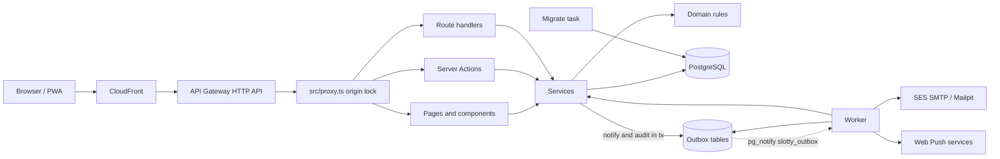
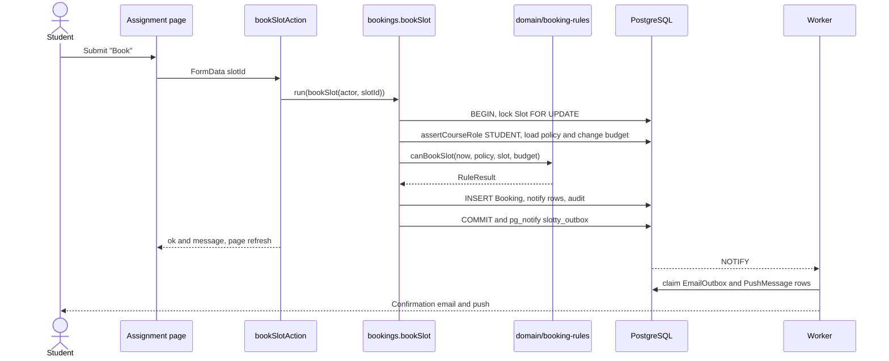
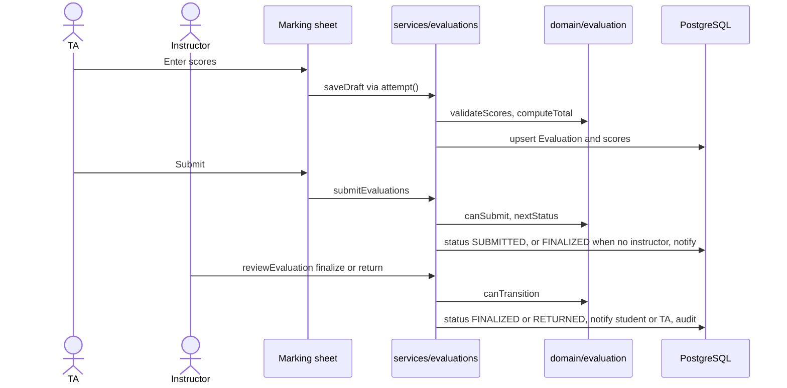
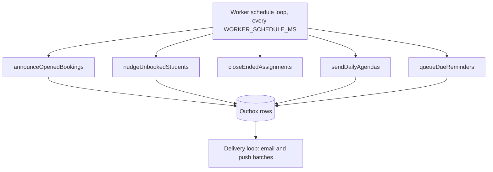

# Architecture — Slotty

## Architecture Analysis

### System Overview
Slotty is one TypeScript codebase that builds one Docker image, which runs in three roles: **web** (Next.js 16 standalone server), **worker** (outbox delivery and scheduled jobs, bundled by Bun) and **migrate** (a one-off `prisma migrate deploy` image target). All roles share one PostgreSQL 17 database. In production this runs on AWS (us-east-1, slotty-prod): CloudFront → API Gateway HTTP API → ECS Fargate ARM64 (web, worker), RDS PostgreSQL, SES for SMTP, SSM for secrets. A single-VPS Compose stack (`deploy/`) runs the same image. Human-written sources: `docs/chapters/05-building-blocks.tex`, `07-cross-cutting.tex`, `08-aws-platform.tex`, `14-decisions.tex` (ADR-001..014).

### Architectural Style
A **modular monolith** with a layered core:
1. **Presentation**: App Router pages and client components (`src/app`, `src/components`).
2. **Adapters**: Server Actions (`src/app/actions`) and route handlers (`route.ts`). They parse the form or request, call one service, and wrap it in `run()` / `attempt()` (`src/server/action-utils.ts`).
3. **Services**: `src/server/services/*`. Each takes an `Actor`, checks access itself (`access.ts`), opens a Prisma transaction, applies rules, writes, and calls `notify()` / `audit()` in the same transaction.
4. **Domain**: `src/domain/*`. Pure functions returning `RuleResult`; `assertRule` turns a denial into a `DomainError`.
5. **Infrastructure**: `src/server/db.ts` (Prisma with `@prisma/adapter-pg`), `mailer.ts`, `push.ts`, `outbox-signal.ts`.

Evidence: `CLAUDE.md` architecture rules, `src/domain/result.ts`, `src/server/services/access.ts`, `src/server/action-utils.ts`.

### Component Relationships

Text fallback: the browser reaches CloudFront, then API Gateway, then the web task, where `src/proxy.ts` checks the origin secret. Pages, Server Actions and route handlers call services. Services use domain rules and write PostgreSQL. Notification side effects go to outbox tables in the same transaction, and `pg_notify` on `slotty_outbox` wakes the worker. The worker delivers email over SMTP (SES in production, Mailpit locally) and Web Push, and runs scheduled jobs that call services. A one-off migrate task applies migrations before each rollout.

### Data Flow
- **Mutations**: form → Server Action → `run()` → service (`db.$transaction`) → domain check → Prisma writes plus `notify()` rows (`Notification`, `EmailOutbox`, `PushMessage`) plus `audit()` → commit → `pg_notify` → `refresh()` of the page.
- **Reads**: server components call service read functions (some layouts read counts from Prisma directly).
- **Async delivery**: the worker claims outbox rows with conditional updates, sends, and records the result (at least once, up to 5 attempts for email).
- **Time**: stored in UTC; formatted in the course timezone by `src/lib/time.ts`, using the viewer's 12h/24h preference set per request (`src/server/clock.ts`).

### Key Design Decisions
- Transactional outbox plus LISTEN/NOTIFY instead of sending email from a request. Because of this there is no RDS Proxy or transaction-mode pooler (project DECIDED rule).
- Row locks (`SELECT … FOR UPDATE` in a sorted order) to serialize slot booking (`bookings.ts` `lockSlots`).
- One image for every role, with configuration read only at runtime. The same image runs locally, on a VPS and on ECS.
- Origin lock with a CloudFront secret header, compared in constant time (`src/proxy.ts`).
- Session cookies with hashed tokens in the database (`src/server/auth/session.ts`), argon2 password hashes.
- Every AWS trade-off is recorded as ADR-001..014 in `docs/chapters/14-decisions.tex` (not repeated here).

### Improvement Opportunities
- Split the largest client components and services (see `code-quality-assessment.md`).
- Run integration tests in CI with a PostgreSQL service container.
- Keep the AI-DLC framework (`.claude/`, `aidlc/`) out of lint and type-check scope (the intent's finding, see `code-quality-assessment.md`).

## Interaction Diagrams

### Student books a slot

Text fallback: the student submits the booking form. `bookSlotAction` calls `bookSlot` inside `run()`. The service locks the slot row, checks the student's role, loads the policy and change budget, and asks `canBookSlot` for a `RuleResult`. On success it inserts the booking, notification outbox rows and an audit entry, then commits. The commit delivers `pg_notify`, which wakes the worker. The worker claims the queued email and push rows and sends the confirmation. A denied rule becomes a `DomainError` that `run()` returns as `{ok:false, error}`.

### TA marks and submits, instructor reviews

Text fallback: the TA's autosave calls `saveDraft` through `attempt()`, which validates and totals the scores. On submit, `submitEvaluations` checks `canSubmit` and moves the evaluation to `SUBMITTED`, or straight to `FINALIZED` when the course has no instructor. The instructor's `reviewEvaluation` checks `canTransition`, then finalizes (marks are released and the student is notified) or returns the evaluation to the TA with a comment. Each step is audited.

### Scheduled jobs

Text fallback: every `WORKER_SCHEDULE_MS` (default 60 s) the worker runs five jobs. Booking-open announcements, nudges, daily agendas and reminders queue outbox rows; auto-close closes ended assignments. When a job queued anything, the delivery loop is woken and sends email in batches of 50 and push in batches of 100.
