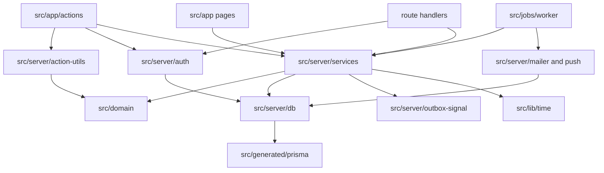

# Dependencies — Slotty

Library versions are in `technology-stack.md`. This file records how things depend on each other.

## External Runtime Dependencies
| Dependency | Used by | Failure behaviour |
|---|---|---|
| PostgreSQL 17 (`DATABASE_URL`) | web, worker, migrate | web `/health` returns 503; the worker's jobs log and retry next loop |
| Postgres LISTEN/NOTIFY | worker delivery loop | falls back to polling every `WORKER_INTERVAL_MS` (15 s) and reconnects with backoff |
| SMTP (`SMTP_HOST`, SES or Mailpit) | worker (`mailer.ts`) | without `SMTP_HOST` emails are printed; a failed send stays in the outbox, up to 5 attempts, then `FAILED` (admins can retry) |
| Web Push services (VAPID keys) | worker (`push.ts`) | push is off when the keys are unset |
| `APP_URL` | links in emails and feeds; origin rewrite | the web and worker processes exit at start-up when invalid |
| `ORIGIN_VERIFY_SECRET` | `src/proxy.ts` (AWS only) | unset means no origin check |
| RDS CA bundle | migrate image and the TLS trust store | pinned by checksum in the `Dockerfile`; a changed bundle fails the build |

## Internal Module Dependencies

Text fallback: pages, actions and route handlers depend on services (actions and routes also on auth, and actions on `action-utils`). Services depend on domain rules, the DB client, the outbox signal and time utilities. The worker depends on services and on the mailer and push delivery modules, which use the DB client. The DB client depends on the generated Prisma client. Domain rules depend on nothing outside `src/domain`.

## Build and Deploy Chain
1. `bun install --frozen-lockfile` → `postinstall: prisma generate` (needs any `DATABASE_URL`; it never connects).
2. CI `check`: `bun run typecheck` (`next typegen && tsc --noEmit`) → `bun run lint` (`eslint`) → `bun run test:unit`.
3. On master: build the `app` and `migrate` images (ARM64) → ECR (immutable SHA tags) → `infra/aws/deploy.sh` (migrate task, then web and worker services).
4. Infrastructure: `infra/aws/org` (management account, S3 state bucket) → `infra/aws/app` (slotty-prod, assumes `OrganizationAccountAccessRole`). `terraform plan` needs human approval before `apply` (project rule).
5. Docs: `docs/tooling/build.sh` in Docker → `docs/build/slotty.pdf` (CI artifact).

## Dependency Risks
- `bun.lock` with `--frozen-lockfile` keeps installs reproducible. `ignoreScripts` (`sharp`, `unrs-resolver`) and `trustedDependencies` limit install scripts.
- Caret ranges (`^`) on most libraries; `next`, `react`, `prisma`, `eslint-config-next` are pinned exactly.
- `@types/node` `^20` while production runs Node 22 (small type drift).
- Lint and type-check scope reaches the vendored AI-DLC TypeScript under `.claude/` (see `code-quality-assessment.md`).
